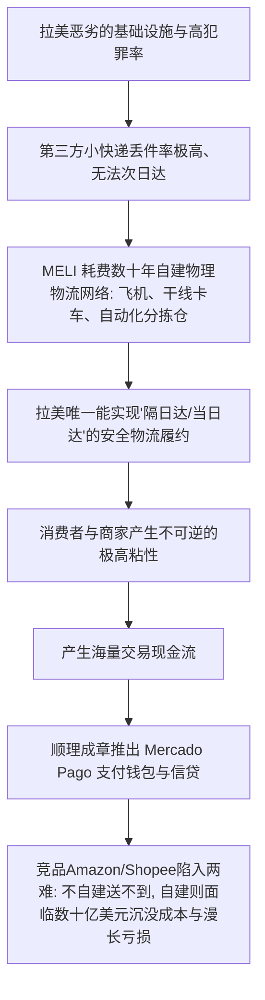
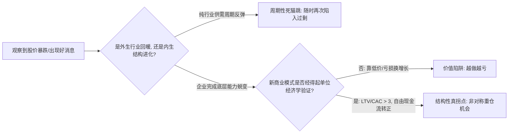

# 《商业透视与价值投资沉思录：从 Rose Celine 到卓越投资者的进阶心法》
> **副标题**：定性商业分析、非对称估值与行为心理护城河的辩证构建指南  
> **作者**：Antigravity 投资方法论研析组（整理汇编）  
> **适用对象**：渴望摆脱机械财务模型、克服追涨杀跌心魔、建立独立商业洞察体系的严肃投资者

---

## 目录
1. [导言与辩证审视：我们到底该向 Rose Celine 学什么？](#导言与辩证审视我们到底该向-rose-celine-学什么)
   - 1.1 为什么要认真学习她的思维框架？
   - 1.2 辩证审视：匿名投资者的天然局限与盲区
   - 1.3 学习姿态：取其骨架心法，弃其皮相推票
2. [第一篇：商业机器的解剖学（The Business Engine）](#第一篇商业机器的解剖学the-business-engine)
   - 2.1 原点还原法：撕掉所有商业术语的三问
   - 2.2 竞争对手视角（Competitor's Curse）：最恶心的护城河才是真护城河
   - 2.3 动态飞轮 vs 静态砖墙：反脆弱生态的构建
   - 2.4 【辩证反思与举一反三】：警惕“飞轮自嗨”与“失血绞肉机”
3. [第二篇：破局变量与非对称拐点（The Inflection Variable）](#第二篇破局变量与非对称拐点the-inflection-variable)
   - 3.1 寻找主要矛盾：过滤 95% 的财务噪音
   - 3.2 深度案例解构：$ROOT 的向死而生与战略拐点
   - 3.3 【辩证反思与举一反三】：如何区分“真拐点”与“死猫跳/价值陷阱”？
   - 3.4 商业史经典拐点对照（微软、苹果、AMD）
4. [第三篇：估值的艺术——餐巾纸心智模型与虚假精确之毒](#第三篇估值的艺术餐巾纸心智模型与虚假精确之毒)
   - 4.1 批判 DCF 拜物教：500 行 Excel 背后的精致伪科学
   - 4.2 Rose Celine 的餐巾纸模型与极简公式
   - 4.3 赔率思维（Odds & Asymmetric Payoff）：不仅看赚多少，更看输得起多少
   - 4.4 【辩证反思与工具边界】：餐巾纸估值法的适用范围与禁区
5. [第四篇：心性与认知防线——行为金融学实战指南](#第四篇心性与认知防线行为金融学实战指南)
   - 5.1 绝症之一：“借来的信念”（Borrowed Conviction）与抄作业的宿命
   - 5.2 绝症之二：“股价上涨的麻醉陷阱”（The Hidden Risk Behind a Rising Price）
   - 5.3 绝症之三：“低估的错觉”（The Illusion of Undervaluation）与烟蒂股坟场
   - 5.4 认知解药：证伪清单（Falsification Protocol）与公开写作压力测试
6. [第五篇：实战行动脚手架——个人投资者 16 步研究全景手册](#第五篇实战行动脚手架个人投资者-16-步研究全景手册)
   - 阶段一：常识盲审（不用看任何财报，大白话讲透商业）
   - 阶段二：单位经济学（Unit Economics）与财务闭环验证
   - 阶段三：压力测试与证伪红线设定
   - 阶段四：建仓纪律与动态跟踪
7. [结语与经典文献对照库](#结语与经典文献对照库)

---

## 导言与辩证审视：我们到底该向 Rose Celine 学什么？

### 1.1 为什么要认真学习她的思维框架？

在整个互联网财经圈（FinTwit、Substack、雪球等），绝大多数内容充斥着两类极端：
1. **短线博弈与技术分析派**：沉迷于 K 线图、移动均线、筹码分布，试图预测明天的资金流向。这本质上是零和博弈甚至负和博弈（扣除手续费与滑点），对理解实体商业毫无帮助。
2. **机械财务教条派**：背诵财务指标，筛选 PE < 15、PB < 1.5、股息率 > 4% 的股票，或者搭建几十个 Tab、上百个假设变量的 DCF（现金流折现）模型。

**Rose Celine（@realroseceline）之所以脱颖而出，是因为她代表了第三种极为稀缺的能力：极高纯度的“第一性原理定性洞察”与“行为金融学免疫力”。**

她身上最值得任何严肃投资者下苦功学习的三大核心资产是：
* **穿透商业迷雾的能力**：能够在五分钟内把一家极其复杂的上市公司（如跨国电商物流、互联网车险、拉美跨境支付）还原成农贸市场卖菜一样朴素直白的底层逻辑。
* **对人性弱点的冷酷洞察**：她对“借来的信念”、“低估的幻觉”、“估值扩张的麻醉剂”的剖析，直击散户在牛熊市中反复割肉亏损的心理死穴。
* **极简主义与大局观**：推崇“餐巾纸测试”，拒绝用复杂的数学模型掩盖对商业模式的无知。

### 1.2 辩证审视：匿名投资者的天然局限与盲区

然而，**如果你全盘盲信她，你一定会摔得头破血流。** 作为辩证的理性人，我们必须首先认清她的局限性与潜在风险：

1. **缺乏经过独立第三方审计的实盘战绩（Track Record）**：
   * 她是匿名博主（Pseudonymous Writer），既没有管理公开对冲基金所需的 13F 季度持仓披露，也没有经过 GIPS（全球投资业绩标准）审计的净值曲线。
   * 网络公开分享天然存在**幸存者偏差（Survivorship Bias）**和**事后叙事构建（Narrative Fallacy）**——人们倾向于多谈做对的 $MELI、$APP、$ROOT，而下意识淡化看平或看错的标的。
2. **极高集中度成长股风格带来的“毁灭性回撤”**：
   * 她的投资风格偏向高集中度（Punch-card）、重仓高成长/网络效应企业。
   * 这类股票的波动率极其剧烈。例如她曾深度持有的拉美跨境支付独角兽 **$DLO（dLocal）**，在遭遇做空报告指控、新兴市场汇率暴跌及高管更迭时，**股价自高点回撤超过 60%~70%**。机构合伙人或财务自由者或许能承受数年腰斩死扛，但普通投资者盲目跟风，几乎必定在最底部恐慌割肉。
3. **“餐巾纸估值”对初学者的误导（粗糙的想象 $\neq$ 严谨的极简）**：
   * 餐巾纸估值法是“大音希声、大象无形”的高阶心法，前提是作者大脑里已经读过成百上千份 10-K 年报，对资产负债表结构、现金流造假套路、债务偿付风险有了直觉般的肌肉记忆。
   * 初学者如果不具备扎实的基本功，直接模仿“餐巾纸粗算”，很容易沦为**“用粗糙的拍脑袋幻想代替尽职调查”**。

### 1.3 学习姿态：取其骨架心法，弃其皮相推票

| 维度 | 应当坚决吸取的“心法骨架” | 应当坚决摒弃的“皮相诱惑” |
| :--- | :--- | :--- |
| **商业理解** | 抓主要矛盾、寻找对手最痛苦的壁垒、拆解商业发动机 | 盲目跟风买入她推文里提到的个股代码（Ticker） |
| **估值建模** | 寻找大维度的非对称赔率、理解稳态利润率与自由现金流 | 放弃对资产负债表与负债到期结构的必要审查 |
| **投资心理** | 拒绝借来的信念、用证伪清单克制自负、耐住寂寞做少数派 | 在自己没看懂的成长股腰斩时盲目效仿他人“死扛” |

---

## 第一篇：商业机器的解剖学（The Business Engine）

任何伟大的投资，起点都必须是：**你真正理解这台机器是如何运转并吐出真金白银的。**

### 2.1 原点还原法：撕掉所有商业术语的三问

商业世界里充斥着企业公关部门发明的空洞黑话：“全域赋能”、“云原生协同”、“端到端 AI 生态”。研究一门生意，第一步就是把所有高大上的 PPT 扔进垃圾桶，回答三个原始问题：

#### 问题一：谁在付钱？买的到底是什么？
人类为商业产品付费的动机，归根结底只有三个层级：
1. **多巴胺与情绪价值（娱乐/社交/身份）**：如任天堂、Netflix、爱马仕。客户买的是快乐、逃避现实或优越感。这类生意的核心是**心智占领与品牌排他性**。
2. **效率工具（降本增效）**：如 Microsoft Office、Salesforce、ServiceNow。客户买的是“用了这个工具，我能裁掉三个后台文员”或“业务流转快了一倍”。这类生意的核心是**投资回报率（ROI）计算**。
3. **生死刚需与止痛药（Painkiller）**：如电力、重疾药物、核心工业零部件、合规保险。不买业务就会停摆、公司就会被吊销牌照、人就会死。这类生意的核心是**极低的需求价格弹性（提价客户也只能忍着）**。

#### 问题二：客户为什么不能离开它？（转换成本与网络效应）
* 如果一家企业把价格上调 10%，客户会立刻换掉它，还是会一边抱怨一边乖乖刷卡？
* 更换它的代价是什么？（是只需点击一下鼠标换个网页，还是需要花半年时间给全体员工重新培训、迁移数据库并承担停机风险？）

#### 问题三：同行提起它时，最恶心它哪一点？
* 世界上最坚固的护城河，从来不是“我也能做，只是我不想做”，而是**“我明知道它怎么赚钱，但我哪怕砸 50 亿美金进去，我也没办法复制它，甚至我越复制亏得越多”**。

---

### 2.2 竞争对手视角（Competitor's Curse）：最恶心的护城河才是真护城河

#### 案例深度拆解：MercadoLibre ($MELI)
外行人看 $MELI，觉得它不过是“拉美地区的 eBay + 淘宝”，伴随着拉美的高通胀、汇率贬值和政治不稳定，似乎不是一门好生意。但 Rose Celine 指出了其真正的护城河壁垒：



**对手的诅咒（Competitor's Curse）**：
* 任何国际巨头（如 Amazon 或 Sea/Shopee）进入拉美，拥有再多云计算技术和算法也没有用，因为**包裹必须在布宜诺斯艾利斯和圣保罗坑坑洼洼的马路上被安全送到客户手里**。
* MELI 做的这件又脏、又累、重资产的苦差事，恰恰把所有轻资产的潜在竞争对手隔绝在门外。

---

### 2.3 动态飞轮 vs 静态砖墙：反脆弱生态的构建

许多人对“护城河”的理解是静态的：一个独家专利、一块地段优越的商铺、一个拥有百年历史的老商标。
**然而，静态的砖墙终究会被时间的铁锤砸碎。** 专利会到期，品牌会被年轻人遗忘，商圈会转移。

真正能穿越周期的顶级企业，拥有的是**“动态自我强化飞轮”（Self-Reinforcing Flywheel）**：

| 飞轮类型 | 运行机制 | 经典代表企业 | 对手为什么打不破？ |
| :--- | :--- | :--- | :--- |
| **规模经济共享 (Scale Economies Shared)** | 规模越大 $\rightarrow$ 单位采购与运营成本越低 $\rightarrow$ 不贪恋短期暴利，将节省成本以极致低价返还用户 $\rightarrow$ 引来更多用户 | **Costco、Amazon、GEICO** | 对手无法打价格战：对手如果降价就会亏损破产，不降价就流失客户。 |
| **双边/多边网络效应 (Two-Sided Network)** | 买家越多 $\rightarrow$ 卖家越多 $\rightarrow$ 商品品类越全/流动性越好 $\rightarrow$ 吸引更多买家 | **Visa / Mastercard、Airbnb、MELI** | 冷启动成本极高：新平台即使技术更好，没有流动性和双边用户也是死城。 |
| **生态级互锁飞轮 (Ecosystem Interlocking)** | 业务 A 带来高频流量与沉淀资金 $\rightarrow$ 衍生出业务 B（支付/金融）提供基础设施 $\rightarrow$ 沉淀数据赋能业务 C（广告/信贷） $\rightarrow$ 反哺业务 A | **苹果、腾讯、MercadoLibre** | 对手即使在单一产品上做到极致，也无法击穿由多个轮子互相咬合的复合系统。 |

---

### 2.4 【辩证反思与举一反三】：警惕“飞轮自嗨”与“失血绞肉机”

> [!CAUTION]
> **辩证警惕：飞轮模型是商业分析中最容易被滥用的“毒药”。**  
> 许多创业公司在路演 PPT 上画一个圆圈，标上四个箭头，就声称自己拥有飞轮。

**真飞轮 vs 假飞轮的本质区别**：
1. **真飞轮越转越轻、自由现金流越来越充沛**：
   * 随着规模扩大，边际成本趋近于零，或者资本回报率（ROIC）持续走高。
2. **假飞轮是“用投资人的真金白银补贴出来的虚假狂欢”**：
   * **共享单车（ofo/Mobike）**：用户越多 $\rightarrow$ 需要投更多单车 $\rightarrow$ 运维、折旧与损耗成本呈指数级上升 $\rightarrow$ 单车变成废铁。这不是飞轮，这是**重资产折旧绞肉机**。
   * **WeWork**：租下更多楼 $\rightarrow$ 包装成协同办公社区 $\rightarrow$ 吸引更多会员 $\rightarrow$ 承诺更长期的高额租金负债。在顺周期时看似飞轮，在逆周期退租时瞬间发生资金链断裂。
   * **Peloton**：疫情期间用户暴增 $\rightarrow$ 自建昂贵工厂与供应链 $\rightarrow$ 疫情结束后需求断崖式下跌，庞大的固定资产折旧把利润彻底吞噬。

**判断法则**：
* 问自己：**如果停止一切外部外部融资和激进补贴，这个飞轮还能不能靠自身的造血机制继续转动？** 如果停掉补贴用户就作鸟兽散，那它不是护城河，只是由补贴堆出来的幻影。

---

## 第二篇：破局变量与非对称拐点（The Inflection Variable）

### 3.1 寻找主要矛盾：过滤 95% 的财务噪音

一份标准的上市公司 10-K 年报长达 150~200 页，包含成百上千项会计科目。
普通人往往迷失在细节中：应收账款周转天数上升了 2 天，管理费用变动了 3%，所得税率微调了 0.5%……

**顶级投资者的研究方法恰恰相反：他们先对企业进行“降维处理”，寻找决定生死的单一主要矛盾。**

在任何企业的生命周期中，通常只有 **1 到 2 个核心物理变量**（而非财务数字）支配着整个商业帝国的未来。一旦这个物理变量发生根本性位移，财报上的利润就会像山洪爆发一样喷涌而出。

---

### 3.2 深度案例解构：$ROOT 的向死而生与战略拐点

Root Inc. ($ROOT) 曾经是华尔街典型的“互联网保险泡沫垃圾股”：上市后一路从高点暴跌逾 90%，市值蒸发几十亿美元，每个季度都在巨额失血。
大多数人看到的是：“这是一家濒临破产的烂公司”。
但 Rose Celine 捕捉到了它的**战略重组拐点（Strategic Inflection Point）**：

#### 1. 旧模式的死亡死锁（为什么过去必死？）
* 过去 Root 采用纯 D2C（直接面向消费者）模式：在 Facebook 和 Google 上疯狂烧钱砸广告吸引年轻司机。
* **致命死穴**：获客成本（CAC）极高。更要命的是，通过线上比价广告来买车险的用户，大多是价格极度敏感、驾驶习惯参差不齐甚至在传统大险企被拒保的劣质客户。
* **结果**：高获客成本 + 高事故赔付率（Loss Ratio > 90%~100%），每多卖出一份保单，公司就向破产深渊滑进一步。

#### 2. 新模式的破局变量（抓住了什么？）
Root 管理层进行了痛苦而决绝的断臂求生，触发了两个决定命运的破局变量：
* **破局变量一：渠道升维——与 Carvana 建立嵌入式分销（Embedded Insurance）**
  * 不再在公域流量上烧一分钱广告。
  * 用户在 Carvana 线上二手车平台选好车、准备结账时，界面弹出一个原生窗口：“每月仅需 \$XX，一键激活车险并提车”。
  * **质变发生**：获客成本（CAC）直接从几百美元腰斩甚至降至接近于零！
* **破局变量二：算法与车载传感数据（Telematics）跨过临界点**
  * 过去所谓“手机传感器监控驾驶行为”被质疑是噱头；但随着数亿英里的行车数据沉淀，Root 的算法模型终于能够精准识别急刹车、夜间超速、边开车边看手机等高危驾驶动作。
  * 公司果断剔除风险最高的 20% 驾驶者，只给优质驾驶者提供极具竞争力的折扣。
  * **质变发生**：净赔付率（Net Loss Ratio）从 90% 崩跌至 60% 以下的健康区间。

#### 3. 拐点推论
当 **“获客成本断崖式下跌”** 与 **“赔付率结构性暴跌”** 两个变量同时共振，Root 的经营杠杆（Operating Leverage）被彻底引爆。原本被市场当成破产垃圾估值的企业，瞬间变成了高资产回报率的现金奶牛。

---

### 3.3 【辩证反思与举一反三】：如何区分“真拐点”与“死猫跳/价值陷阱”？

> [!WARNING]
> **困境反转（Turnaround）是价值投资领域埋葬资本最多的公墓。**  
> 芒格曾说：“绝大多数声称正在扭亏为盈（Turnaround）的公司，最终都没有扭转过来。”

你必须学会辨别**“结构性真拐点”**与**“周期性死猫跳（Dead Cat Bounce）/价值陷阱”**的六大铁律：



| 判别维度 | 价值陷阱 / 死猫跳（假拐点） | 结构性真拐点（真机会） |
| :--- | :--- | :--- |
| **驱动力量** | 仅仅依靠行业供求关系的短周期回暖（如猪周期、航运暴涨、大宗商品提价） | 企业本身完成了**商业模式、分销渠道或技术代差的质变** |
| **资本开支与研发** | 依靠无底线压缩研发与设备维护来强行挤出短期利润 | 保持研发的同时，通过单位经济学（Unit Economics）优化实现自然盈利 |
| **管理层言行** | 管理层整天在财报电话会上甩锅（怪天气、怪通胀、怪宏观），画宏大饼 | 管理层诚实面对过去的战略愚蠢，给出清晰、可量化验证的关键运营里程碑 |
| **客户行为** | 客户依旧觉得该公司的产品可有可无，只要竞品便宜立刻叛逃 | 客户因新的产品形态产生更深粘性，留存率（Retention）和 NPS 显著提升 |

---

### 3.4 商业史经典拐点对照

1. **微软（2014 年萨提亚·纳德拉上任）**：
   * *假象*：Windows 个人电脑出货量见顶，智能手机操作系统 Windows Phone 惨遭 iOS 和 Android 绞杀，被视为“过气的科技化石”。
   * *真拐点*：彻底打破 Windows 藩篱，把 Office 拥抱到全平台（甚至 iOS 和 Android），并将全公司资源押注在云计算 Azure 上。由卖一次性授权升级为 SaaS 订阅 + 云计算，估值体系彻底重构。
2. **AMD（2017 年苏姿丰发布 Zen 架构）**：
   * *假象*：常年被 Intel 压制，推土机架构发热严重、性能拉垮，公司一度濒临破产边缘。
   * *真拐点*：果断放弃自建晶圆厂的沉重包袱（剥离 GlobalFoundries），全力专注 Chiplet 小芯片设计，并果断抱紧**台积电先进制造工艺**的大腿。当台积电制程反超 Intel 时，AMD 凭借 Zen 架构在服务器和 PC 市场实现了对 Intel 的物理级降维打击。

---

## 第三篇：估值的艺术——餐巾纸心智模型与虚假精确之毒

### 4.1 批判 DCF 拜物教：500 行 Excel 背后的精致伪科学

在主流投行和商学院中，DCF（折现现金流模型）被奉为圣经。分析师们热衷于搭建极其复杂的电子表格：
* 预测第 8 年的应收账款周转率；
* 假定无风险利率为 3.42%，股权风险溢价为 5.18%，算出 WACC（折现率）为 8.23%；
* 最终得出一个极具戏剧性的结论：“该股票的内在价值为 \$73.48”。

**这种行为被称为“虚假精确（False Precision）”。**

巴菲特多次告诫：**“宁要模糊的正确，不要精确的错误。”**
一个 500 行的模型只要稍微把折现率从 8.23% 改成 7.5%，或者把永续增长率从 2.5% 改成 3.0%，计算出来的内在价值就可以相差 50% 甚至翻倍。**模型并没有帮助分析师看清未来，它只是成了分析师为自己内心的偏见寻找数字合理化的工具。**

---

### 4.2 Rose Celine 的餐巾纸模型与极简公式

如果一笔投资需要借助高等微积分或几十个联立方程式才能证明它便宜，那它通常已经不便宜了。
Rose Celine 推崇的**“餐巾纸测试”（The Napkin Test）**，本质上是用最少、最坚实的假定，算出一张非对称回报的底牌：

$$\mathbf{V_{5Y} = \text{Revenue}_{5Y} \times \text{Steady State Net Margin} \times \text{Terminal P/E Multiple}}$$

$$\text{预期年化复合收益率 (CAGR)} = \left( \frac{V_{5Y}}{\text{当前市值}} \right)^{1/5} - 1$$

#### 餐巾纸测算的四步心法：
1. **五年后收入估计（保守压测）**：
   * 不看管理层吹嘘的 50% 高增长，基于行业空间、渗透率饱和度和市占率上限，给出一个即使经济遭遇逆风也能稳妥实现的五年后营收规模。
2. **稳态净利润率（Steady-State Margin）**：
   * 许多成长股或拐点企业当前是亏损的（因为正在激进扩张研发或渠道）。
   * 必须思考：**当这门生意成熟、不再需要维持激进的销售与营销支出时，它的稳态结构利润率是多少？**（毛利率扣除必要的留存维护研发和后台管理开支）。
3. **终局退出倍数（Terminal Multiple）**：
   * 永远不要假设市场在五年后还会给它 50 倍、80 倍的狂热估值。
   * 针对其商业模式的质量，给出一个保守合理的成熟期倍数（例如：平庸商业给 12~15x，优质网络效应商业给 20~25x）。
4. **安全边际与现值对照**：
   * 用算出来的五年后价值倒推，如果当前市值能提供 **每年 20%~30% 以上的内生复合回报率（即 5 年 2.5~3 倍空间）**，同时向下有净现金资产或清算价值兜底，这才是真正的大机会。

---

### 4.3 赔率思维（Odds & Asymmetric Payoff）：不仅看赚多少，更看输得起多少

伟大的投资者从不试图做“百发百中的神枪手”，他们是**赌场庄家式的概率学家**。

单笔投资的评价标准不是“它涨了没有”，而是**你在承担多大风险的前提下追求了多大的潜在赔率**：

```
       潜在上涨空间 (Upside)
           ▲
           │         ★ 卓越投资 (Asymmetric Bet)
           │           [向下亏 20%, 向上赚 300%]
           │
           │
           │   ● 平庸博弈
           │     [向下亏 50%, 向上赚 50%]
───────────┼──────────────────────────────► 潜在亏损风险 (Downside)
           │
           │   ✖ 愚蠢赌博
           │     [向下亏 100%, 向上赚 20%]
           ▼
```

* **平庸投资**：赢了赚 30%，输了亏 30%（抛硬币，长期被交易摩擦成本吃光）。
* **危险投资**：在估值百倍的泡沫期买入所谓的伟大公司，向上还能涨 20%，向下估值腰斩可能亏 70%。
* **非对称投资（Asymmetric Investing）**：
  * **向下有硬资产或核心业务托底**：比如公司账上有 10 亿净现金，市值只有 12 亿，哪怕新业务彻底失败，把公司清算也能拿回本金的大半（最大下行风险被锁死在 15%~20%）。
  * **向上拥有无限期权（Free Option）**：一旦新业务或战略拐点被证实，公司的盈利能力将扩大数倍，市值有 300%~500% 的弹性。

---

### 4.4 【辩证反思与工具边界】：餐巾纸估值法的适用范围与禁区

> [!IMPORTANT]
> **工具没有好坏，只有错配。餐巾纸估值法有其绝对不可逾越的应用边界。**

#### 适合使用餐巾纸估值法（极简推演）的行业：
1. **轻资产、高 ROIC 的数字平台与软件（SaaS / Platform）**：边际成本低，现金流充沛，单位经济学明确。
2. **高粘性、高复购的消费与服务连锁**：单店模型（Unit Economics）稳定，门店天花板和单店回收期易于量化。
3. **拥有强大定价权（Pricing Power）的垄断特许经营企业**。

#### 严禁使用餐巾纸估值法（必须进行重度资产与负债详尽审查）的行业：
1. **高负债金融与银行机构**：
   * 银行资产负债表只要有 2% 的底层不良资产暴雷，其全部股东权益（Equity）就会在瞬间灰飞烟灭（如硅谷银行 SVB 的利率久期错配）。餐巾纸模型根本无法捕捉这种隐性资产风险。
2. **重资产强周期行业（航运、钢铁、采矿、多晶硅）**：
   * 周期顶峰时的“稳态净利润率”完全是海市蜃楼。用周期高点的利润去乘一个倍数，是散户被套在周期山顶最惨烈的原因。
3. **早夭型生物医药公司（Biotech）**：
   * 研发管线的临床三期试验是二元生死的（要么成功飞天，要么失败归零）。没有确定性的收入基数，餐巾纸算出来的全是空想。

---

## 第四篇：心性与认知防线——行为金融学实战指南

投资是一场反人性的游戏。你在智力上理解了前三篇的内容，大概只能保证你不在起跑线上被淘汰；**真正决定你在市场中能活 5 年还是 30 年的，是你的心性防护网。**

### 5.1 绝症之一：“借来的信念”（Borrowed Conviction）与抄作业的宿命

散户最常见的悲剧莫过于：在推特或雪球上看到某个崇拜的投资大 V（哪怕是巴菲特或段永平）买入了一只股票，并写出了一篇令人热血沸腾的深度分析。散户毫不犹豫地全仓买入。

#### 为什么“抄作业”注定通往毁灭？
1. **你无法抄走别人的成本线与仓位比例**：
   * 大 V 买了 2% 仓位，当成看涨期权；你以为是大机会，直接押注了 50% 甚至加了杠杆。
2. **你无法抄走别人的资产负债表与抗压能力**：
   * 大 V 账上现金流源源不断，股票跌了 50% 他可以轻松补仓或谈笑风生；你用的是明年结婚买房的钱，跌了 30% 就寝食难安。
3. **最致命的：信念在暴跌中无法外包**：
   * 当市场遭遇系统性暴跌、负面新闻铺天盖地、社交媒体上全是做空质疑时，**借来的信念会在瞬间粉碎**。
   * 因为你从未亲自去翻过 10-K，从未亲自核算过供应商数据，你根本不知道外界的指控到底是致命的真相还是暂时的噪音。
   * **最终结果**：你在恐惧的极点、在真正的黄金坑底，亲手割掉带血的筹码，并在随后的大反弹中痛心疾首。

> **核心心法**：**真正的确定性（Conviction）是一种必须通过个人亲手推导、流汗调查才能获得的心理防御资产。未经苦研的盲从，在第一道风浪面前就会沉没。**

---

### 5.2 绝症之二：“股价上涨的麻醉陷阱”（The Hidden Risk Behind a Rising Price）

Rose Celine 在《The Hidden Risk Behind a Rising Stock Price》中提出了一个发人深省的命题：**股价上涨，往往是诱导投资者犯下大错的最强毒品。**

#### 区分财富增长的两种来源：
$$\Delta \text{股价} = \Delta \text{内生每股收益 (EPS)} + \Delta \text{估值倍数 (P/E Multiple)}$$

```
【健康而长寿的复利】               【危险而脆弱的泡沫】
        ▲                               ▲
        │                               │
        │ 股价平稳上涨 / 波动震荡          │ 股价一飞冲天 (狂热暴涨)
        │                               │
        │                               │
 ───────┴──────────────────────── ──────┴────────────────────────
   企业内在利润 (EPS) 扎实翻倍        企业利润原地踏步, 纯靠估值倍数
   (安全感极强, 随时有业绩托底)        从 15x 炒到 60x (宛如空中楼阁)
```

1. **估值倍数是带毒的杠杆**：
   * 当一只股票从 15 倍 PE 被资金炒作到 50 倍 PE 时，投资者会产生幻觉：“我太英明了，我的逻辑完全被市场验证了！”
   * **残酷真相**：这根本不是逻辑被验证，这只是市场的动物精神（Animal Spirits）和流动性溢价。
   * 当估值被拔高到极致，企业只要交出一份“良好但未达到神话级超预期”的财报，迎来的就是**戴维斯双杀（盈利增速放缓 + 估值倍数腰斩）**，几天的跌幅就能抹平三年的浮盈。
2. **真正的安全感来自于哪里？**
   * 真正有经验的老手最喜欢的状态，反而是在买入后：**股价在底部死死横盘甚至阴跌一两年，而底层的业务量、客户数、净利润每年以 30% 默默爬坡。**
   * 这种“被市场冷落的扎实增长”，就像被死死压住的弹簧，时间越长，积蓄的内生爆发力越恐怖，而且下行风险几乎为零。

---

### 5.3 绝症之三：“低估的错觉”（The Illusion of Undervaluation）与烟蒂股坟场

在格雷厄姆早期的经典价值投资中，强调买入低 PE、低 PB、甚至破净（低于清算价值）的“烟蒂股（Cigar Butt）”。
Rose Celine 在《The Illusion of Undervaluation》中尖锐地指出了这一流派在现代商业环境下的破产：

1. **便宜往往是最昂贵的代价**：
   * 一家公司之所以交易在 5 倍 PE、0.4 倍 PB，通常是因为**它的资本回报率（ROIC）低于资本成本（WACC），或者它的行业正在走向永久性萎缩**（如传统报纸、胶卷、缺乏研发实力的仿制药）。
   * 每一天过去，这类企业都在摧毁股东价值。如果时间是平庸企业的朋友，时间就是卓越企业的敌人。
2. **再投资摩擦与持续交易的诅咒**：
   * 哪怕你运气好，以 5 折买到了一个平庸的烟蒂股，并在它反弹到 8 折时卖出：
     * 你必须承担高昂的短期资本利得税和交易摩擦成本；
     * 你必须立刻寻找下一个打折的烟蒂股；
     * **你的一生都在不断地寻找濒死病人，一旦他能下床走路就赶紧卖掉，再找下一个病人。只要有一次踩雷永久破产，全盘皆输。**
3. **查理·芒格的终极顿悟**：
   * **“宁愿以合理的价格买入一家伟大的公司，也绝不要以极低的价格买入一家平庸的公司。”**
   * 伟大的公司拥有高再投资率与深厚的护城河，你可以安心持有它十年、二十年，让企业内部的天才管理者帮你复利打工，免除频繁换仓的税负和心智消耗。

---

### 5.4 认知解药：证伪清单（Falsification Protocol）与公开写作压力测试

为了抵抗自负和偏见，必须在实战中装备两套“自我纠偏武器”：

#### 武器一：事前证伪清单（Falsification Protocol）
在把一分钱打入券商账户之前，必须在一张纸上白纸黑字写下 **3 条不可逾越的“退场红线”**：
* *红线示例*：“如果在未来 4 个季度内，该公司的客户净留存率（NDR）跌破 110%，或者核心分销合作伙伴终止合作，说明产品壁垒被击穿，我将无条件平仓认赔出局，绝不找任何借口。”
* **作用**：当未来黑天鹅降临、股价暴跌时，你不再会被情绪左右。拿出生前遗嘱一样的清单核对：
  * **红线没踩？** 那么暴跌纯属市场发疯，坚决利用恐慌贪婪加仓；
  * **红线踩了？** 说明核心假设被破坏，哪怕浮亏 40%，也立刻手起刀落斩仓离场，绝不死扛沉没成本。

#### 武器二：公开写作与同行压力测试
把你的投资逻辑写成公开的研报或分析长文，分享在专业社群或公开平台上。
* 写作会逼迫你的大脑把模糊、跳跃的直觉转换成严丝合缝的因果逻辑链。
* 欢迎最刻薄的空头同行来挑刺。如果有人指出了一个你从未考虑过的致命漏洞，你应该感激他——**因为他在思想层面杀死了你的错误想法，为你保全了真金白银。**

---

## 第五篇：实战行动脚手架——个人投资者 16 步研究全景手册

将上述所有理论凝结为一张可执行、可落地的实操清单（Checklist）：

```mermaid
flowchart TD
    subgraph 阶段一：常识盲审
        A1[1. 原点三问：大白话解释谁在掏钱买什么] --> A2[2. 痛点测试：是多巴胺、效率工具还是生死刚需]
        A2 --> A3[3. 对手诅咒：竞争对手最头疼它什么]
        A3 --> A4[4. 飞轮健康度：自发造血还是失血空转]
    end

    subgraph 阶段二：单位经济学验证
        A4 --> B1[5. 拆解单客经济模型: LTV/CAC 是否 > 3]
        B1 --> B2[6. 留存与粘性: NDR与毛流失率是否健康]
        B2 --> B3[7. 剥离经营杠杆: 稳态净利率测算]
        B3 --> B4[8. 现金流纯度: 自由现金流 vs 账面净利润]
    end

    subgraph 阶段三：压力测试与证伪
        B4 --> C1[9. 极端逆境测试: 营收跌30%能撑几年]
        C1 --> C2[10. 负债结构排查: 未来2年是否有高息债务到期]
        C2 --> C3[11. 建立证伪清单: 明确写下3条死刑红线]
        C3 --> C4[12. 餐巾纸估值: 算清5年复合收益率与赔率]
    end

    subgraph 阶段四：知行合一纪律
        C4 --> D1[13. 分批建仓: 绝不在初始未验证时一把梭哈]
        D1 --> D2[14. 钝感力修炼: 屏蔽短期分时图与每日播报]
        D2 --> D3[15. 季度跟踪: 仅对照核心破局变量进展]
        D3 --> D4[16. 知行合一退出: 踩红线即斩, 估值极度透支即走]
    end
```

### 详尽步骤说明手卡：

| 阶段 | 步骤 | 关键动作与检查标准 | 常见不及格表现 |
| :--- | :--- | :--- | :--- |
| **阶段一：常识盲审** | 1. 原点还原 | 能否用给 12 岁小孩讲故事的语言，在 2 分钟内讲清它怎么赚钱？ | 满口“分布式”、“全栈赋能”等行业黑话。 |
| | 2. 需求定性 | 它是维他命（可有可无）还是止痛药（非买不可）？ | 靠强行推销给客户，客户第二年就不续费。 |
| | 3. 对手视角 | 假定你是同行 CEO，给你 1 亿美金，你能抢掉它多少份额？ | 竞品只需降价 10%，该公司的客户就跑光了。 |
| | 4. 飞轮自洽 | 规模扩大到底是带来了边际成本下降，还是带来了管理失控？ | 收入翻倍，亏损却翻了两倍。 |
| **阶段二：财务验证** | 5. 单位经济学 | 单客户全生命周期价值（LTV）与获客成本（CAC）是否匹配？ | 获客成本节节攀升，用户生命周期价值算不过来账。 |
| | 6. 客户留存 | 净金额保留率（NDR）是否持续大于 100%？ | 每年必须不断获取新客户才能勉强填补老客户流失的窟窿。 |
| | 7. 稳态利润率 | 剥离目前激进的扩张期支出，成熟期的 EBIT Margin 有多少？ | 误以为目前的亏损是“战略亏损”，实则是永久性不赚钱。 |
| | 8. 现金流验证 | 自由现金流（FCF）是否等于甚至高于净利润？ | 账面利润很高，但全压在存货和应收账款里，常年借新还旧。 |
| **阶段三：压力测试** | 9. 极限生存 | 如果经济遭遇大萧条、营收骤降 30%，账上净现金够活几年？ | 营运资金只能撑 6 个月，随时面临折价增发稀释老股东。 |
| | 10. 债务排查 | 关注短期借款、可转债到期日及利息覆盖倍数。 | 资产负债率极高，一旦银行抽贷立刻猝死。 |
| | 11. 证伪红线 | 明确写出 2~3 项“若发生则证明自己彻底看错”的具体事件。 | 从不承认自己看错，股价跌了就无限找新理由自我安慰。 |
| | 12. 餐巾纸估值 | 5 年后的预期市值是否显著高于当前市值？（非对称赔率）。 | 哪怕在最乐观的假设下，五年后也只有个位数的年化回报。 |
| **阶段四：纪律执行** | 13. 阶梯建仓 | 初始建仓 30%~50%，留足子弹，随里程碑兑现逐步加仓。 | 一旦看好就上满杠杆，被一次正常波动震出局。 |
| | 14. 屏蔽噪音 | 不看分时 K 线，不听财经小道消息，专注于真实经营世界。 | 每天盯盘 4 小时，心跳跟着股价红绿剧烈起伏。 |
| | 15. 核心跟踪 | 季度财报只核对“破局变量”是否在正轨上推进。 | 被季度 EPS 差 1 美分的小波动吓得仓皇抛售。 |
| | 16. 退出执行 | 唯二的卖出理由：核心假设被证伪；或者估值透支了未来 5 年的全部业绩。 | 因为赚了 20%“想落袋为安”而错失十倍复利大牛股。 |

---

## 结语与经典文献对照库

投资是一场漫长而孤独的智识修炼。Rose Celine 的价值，不在于她给你指出哪一只具体的股票，而在于她像一面镜子，映照出我们在市场狂欢与恐慌中的贪婪、虚荣与懦弱。

要将这套体系彻底熔铸进你的直觉，建议将本指南与以下投资大师的原著配合对照精读：

1. **商业模式与竞争优势**：
   * 帕特·多尔西：《巴菲特的护城河》（*The Little Book That Builds Wealth*）——系统化拆解无形资产、转换成本、网络效应与成本优势。
   * 尼克·斯利普：《扎克投资书简》（*Nomad Investment Partnership Letters*）——对“规模经济共享（Scale Economies Shared）”商业模式的最深刻阐述。
2. **投资心理学与行为偏差**：
   * 霍华德·马克斯：《投资最重要的事》（*The Most Important Thing*）——关于第二层次思维、周期认知与风险不对称性的传世之作。
   * 丹尼尔·卡尼曼：《思考，快与慢》（*Thinking, Fast and Slow*）——理解大脑直觉陷阱与过度自信的认知神经学基础。
3. **破局拐点与非对称博弈**：
   * 莫尼斯·帕伯莱：《达钱方法》（*The Dhandho Investor*）——“掷出正面我赢，掷出反面我输得很少”的非对称赔率实战哲学。
   * 安迪·格鲁夫：《只有偏执狂才能生存》（*Only the Paranoid Survive*）——精准定义什么是商业的“战略转折点（10X 力的出现）”。

> **致学习者**：  
> 永远保留一份对市场的敬畏，永远保留一份对自我的怀疑。  
> **不要借用任何人的信念，亲手去推导你的每一笔投资。**
